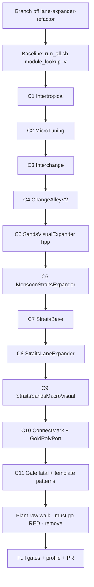

# Plan — Module-Lookup Authority: FINISH THE TAIL

Source prompt: `docs/design/CC_PROMPT_MODULE_LOOKUP_TAIL_START.md`
Base branch: `lane-expander-refactor` → work branch: `module-lookup-tail-finish` (new)
Rule: **one module per commit, build+test gated, behaviour-identical.**

## 1. Current state (verified by code inspection)

Done + green (PR #293, 13 modules): Monsoon, Lantern, Changi/T2/T3, Causeway, Junction,
Raffles, Shophouse, ShophouseMicro, Sikit, StraitsEastSandsVisual, StraitsSandsMacroVisual
(mostly), MonsoonExpanderManager, MonsoonSandsManager. All have
`onExpanderChange → redDot::bumpTopologyEpoch()`.

The service: `src/ui/ModuleLookupCore.hpp` (epoch + single-entry-per-question
`thread_local` memo, keyed `(self, key, epoch)` per `Walk` instantiation) and
`src/ui/ModuleLookup.hpp` (typed accessors `lookupMonsoon` / `lookupConnectedAndClaimed` /
`lookupPairHub<T>` / `lookupFollowed<T>` / `lookupIntertropical`).

The gate: `test/test_module_lookup.cpp` L5 — line-scan of `src/**` for 9 raw-walk
substrings, excluding `src/deprecated/`, 5 allow-listed service/primitive headers
(`ModuleLookup.hpp`, `ModuleLookupCore.hpp`, `VisualExpanderHelpers.hpp`,
`IntertropicalPairing.hpp`, `MonsoonDiscovery.hpp`), and any line carrying the
`LOOKUP-AUTHORITY` marker. Currently **residual mode** (fatal only under
`MODULE_LOOKUP_STRICT=1`).

### Residual inventory (replicated gate scan — confirm at implementation start with
`bash test/run_all.sh module_lookup -v`; expect it to match)

**Gate-visible raw-walk lines (37):**

| File | Lines | Sites |
|---|---|---|
| `src/Intertropical.cpp` | 76, 83, 634 | pairId one-shot; `hostLookupDiv_`/`cachedHost` refresh; ConnectMark reachability lambda |
| `src/MicroTuning.cpp` | 34, 116, 269, 558, 742 | process publish walk; `findMonsoonEitherSide(sm)` in ixScan rebuild; draw theme lambda; connectMark connected; widget step theme |
| `src/MonsoonInterchangeExpander.cpp` | 55 | widget `getMonsoon()` helper |
| `src/MonsoonChangeAlleyV2.hpp` | 751, 902, 956, 1387 | arc `isActive`; `getPolyCount`; PinOverlay theme; step theme swap |
| `src/MonsoonSandsVisualExpander.hpp` | 64 | `monoMacroOwnsEngineLane` (called engine-side from MonsoonSandsManager) |
| `src/MonsoonStraitsExpander.cpp` | 107, 111, 115, 158, 168, 181, 193, 203, 294, 326 | 3 arc lambdas; 5 `displayValueFn`; step themeLight_; post-step theme |
| `src/StraitsBase.cpp` | 241, 334 | widget step theme+voice-sync; post-step theme |
| `src/StraitsLaneExpander.cpp` | 147, 151, 155, 196, 268, 283 | 3 arc lambdas; `displayValueFn`; step theme; post-step theme |
| `src/StraitsSandsMacroVisual.hpp` | 210, 211 | `macroSpreadModulatesLane` double-walk (macro send) |
| `src/ui/ConnectMark.hpp` | 66, 67 | `connected` / `lightTheme` factory lambdas |
| `src/ui/GoldPolyPort.hpp` | 14 | **comment only** — usage example in the header doc |

**Gate-INVISIBLE template-form raw walks (6) — the gate's substring match misses
`resolveFollowedT<X>(`, `assignPairIdT<X>(`, `findPairHubEitherSide<X>(`:**

| File | Line | Site |
|---|---|---|
| `src/MonsoonInterchangeExpander.hpp` | 81 | `resolveFollowedT<MicroTuningModule>` inside `targetScanDiv_` |
| `src/MonsoonInterchangeExpander.cpp` | 138, 225 | `drawTargetBadge`; follow-menu hub naming |
| `src/MicroTuning.cpp` | 32, 108 | pairId one-shot (PRESERVE per doc); AUTO-bind check in ixScan rebuild |
| `src/MonsoonChangeAlleyV2.hpp` | 424 | pairId identity settle (PRESERVE) |

Worklist items already done (verified, do NOT re-do): MonsoonShophouseMicro, Sikit,
MonsoonChangiT3, MonsoonExpanderManager (only a stale include comment remains),
Monsoon.cpp/.hpp (2 sites already LOOKUP-AUTHORITY-marked), StraitsSandsMacroVisual.cpp.
`src/deprecated/*` — excluded by the gate, never convert. `MonsoonDiscovery.hpp` is an
allow-listed primitive header and currently has **no** raw-walk call sites (worklist
entry is stale).

## 2. Canonical conversion recipe (from the landed 13)

- Host question → `redDot::lookupMonsoon(self)`.
- Follow question → `redDot::lookupFollowed<T>(self, followId)` — the followId is the
  memo KEY, so a knob turn re-resolves without any event.
- Claimed/connected question → `redDot::lookupConnectedAndClaimed(self)`.
- Module keeps its own cached member? → guard with `redDot::lookupEpochStale(epochMember_)`
  and rebuild (the `Monsoon::updateExpanderPointers` pattern, Monsoon.cpp:1414-1419).
- Every converted module gets:
  `void onExpanderChange(const ExpanderChangeEvent& e) override { redDot::bumpTopologyEpoch(); }`
  (exact idiom of MonsoonChangiT2Expander.hpp:36-39) — the epoch's fan-out needs every
  suite module adjacent to a change to bump.
- Identity settles (`assignPairId*` one-shots in `process()`) are **preserved in place**
  with a `— LOOKUP-AUTHORITY (one-shot identity settle…)` marker (Monsoon.cpp:146
  precedent; the doc's MicroTuning ruling).
- Delete the module's lookup divider + its cached pointer member.

## 3. Commit sequence

Each commit: convert sites, add `onExpanderChange` bump where the module lacks it,
delete that module's divider, then `bash test/run_all.sh` green + `make RACK_DIR=../Rack-SDK`
warning-clean + targeted `run_all.sh module_lookup -v` shows the count dropped. No time estimates.

### C1 — Intertropical (`.hpp` + `.cpp`)
- Delete `hostLookupDiv_` + `cachedHost` members; `process()` host resolve →
  `redDot::lookupMonsoon(this)`.
- `getHost()`: declare in `.hpp`, **define in `.cpp`** returning `redDot::lookupMonsoon(this)`.
  Do NOT include `ModuleLookup.hpp` from `Intertropical.hpp` — include cycle:
  `ModuleLookup.hpp → IntertropicalPairing.hpp → Intertropical.hpp` (IntertropicalPairing.hpp:15).
  Lantern reads via `getHost()` only; no other `cachedHost` readers (verified).
- :76 `assignPairId` one-shot — preserved + LOOKUP-AUTHORITY marker.
- :633 ConnectMark reachability lambda → `redDot::lookupMonsoon(module) != nullptr`.
- Add `onExpanderChange` override.

### C2 — MicroTuning (`.hpp` + `.cpp`)
- :34 publish walk → `lookupMonsoon(this)`.
- `ixScanDiv_` deleted (member + init) → rebuild `boundInterchanges_` + `boundShophouseMicro_`
  under `if (redDot::lookupEpochStale(ixScanEpoch_))` (new `uint64_t ixScanEpoch_ = 0`,
  runtime-only). :108 + :116 stay inside the rebuild → LOOKUP-AUTHORITY markers
  (epoch-guarded resolve).
- :32 `assignPairIdT<MicroTuningModule>` one-shot — preserved + marker.
- Widget: :269 draw theme lambda, :558 connectMark connected, :742 step theme →
  `lookupMonsoon` (Sikit.cpp:61/:142/:207 are the converted twins).
- Add `onExpanderChange` override to `MicroTuningModule`.
- **Known edge (document in PR):** re-targeting an Interchange's `followTarget` via its
  menu on a fully static rack no longer refreshes Micro's mirror until the next epoch
  bump. The Interchange's OWN binding stays instant (followId is the memo key). Same
  semantics class as the landed `followCA` resolution on Monsoon.

### C3 — MonsoonInterchangeExpander (`.hpp` + `.cpp`)
- Delete `targetScanDiv_` (member + setDivision + gate). `microBoundCached_` STAYS (it is
  read engine-side via `drivesMonsoonCached()` from MonsoonParameterManager.cpp:128/145/171)
  but is refreshed **every process block** via
  `lookupFollowed<MicroTuningModule>(this, followTarget)` — memo hit ≈ one atomic load;
  strictly fresher than /64; flag semantics identical.
- :55 widget `getMonsoon()` → `lookupMonsoon(module)`; :138 `drawTargetBadge` →
  `lookupFollowed<MicroTuningModule>(mod, mod->followTarget)`; :225 follow-menu hub
  naming → `lookupFollowed<...>(mod, pid)` (menu-time; key alternation is fine there).
- Add `onExpanderChange` override.

### C4 — MonsoonChangeAlleyV2 (`.hpp` — the fiddly header case)
- Add `#include "ui/ModuleLookup.hpp"` (safe: the hpp already transitively includes
  `VisualExpanderHelpers.hpp`/`Monsoon.hpp` via ConnectMark.hpp:24; widget sites sit far
  below all includes; no new cycle).
- :751 arc `isActive`, :902 `getPolyCount`, :956 PinOverlay theme, :1387 step theme →
  `lookupMonsoon`.
- :424 `assignPairIdT<MonsoonChangeAlleyV2>` identity settle — preserved + marker.
- Add `onExpanderChange` override to the module struct.
- **`hostScanDiv_` → epoch-gated refresh** (Rodney's ruling): delete the divider member +
  the `setDivision(1024)` init; replace `if (hostScanDiv_.process()) refreshConnectedHosts();`
  with `if (redDot::lookupEpochStale(hostScanEpoch_)) refreshConnectedHosts();` (new
  `uint64_t hostScanEpoch_ = 0`, runtime-only). The data it reads
  (`Monsoon::expanderManager.cachedChangeAlleyV2`) is itself event/epoch-driven and
  Monsoon::onExpanderChange updates eagerly inside the event, so CA's next process sees
  fresh caches. First-block behaviour preserved (epoch starts at 1 ≠ cached 0 → immediate
  refresh). Staleness class now identical to the landed followCA resolution.

### C5 — MonsoonSandsVisualExpander (`.hpp`)
- `monoMacroOwnsEngineLane` :64 → `lookupMonsoon(mod)`; include swap
  `VisualExpanderHelpers.hpp` → `ModuleLookup.hpp` (its only consumer of that header).
- Delete the **dead** `monLookupDiv` + `cachedMon_` + `setDivision(8)` — the module is
  RETIRED (stub .cpp, model nullptr, uninstantiable; no `.cpp` references these members).
- No `onExpanderChange` (cannot be instantiated, never sits in a chain).

### C6 — MonsoonStraitsExpander (`.hpp` + `.cpp`)
- Convert all 10 sites → `lookupMonsoon` (3 arc lambdas, 5 `displayValueFn`, step
  `themeLight_`, post-step theme swap). `themeLight_` member stays (knob `lightWhen`
  reads it; only the walk source changes).
- Add `onExpanderChange` override.

### C7 — StraitsBase (`.hpp` + `.cpp`)
- :241 (step: theme + voice-count sync into `mm->engine.numPolyVoices`) and :334
  (post-step theme) → `lookupMonsoon(module)`.
- Add `onExpanderChange` override to `StraitsBaseModule`.

### C8 — StraitsLaneExpander (`.hpp` + `.cpp`)
- Convert 6 sites → `lookupMonsoon` (3 arc lambdas via `self->module`, 1
  `displayValueFn`, step theme, post-step theme).
- Add `onExpanderChange` override.

### C9 — StraitsSandsMacroVisual (`.hpp`)
- :210-211 double-walk → single `Monsoon* mm = redDot::lookupMonsoon(macro);`
  (include already present at hpp:9). Module already has `onExpanderChange`.

### C10 — ConnectMark.hpp + GoldPolyPort.hpp (widget-header special-case pair, one commit)
- **ConnectMark — CONVERT (judgment):** stable module key (captured per widget), and both
  questions have purpose-built memoized accessors. `connected` →
  `redDot::lookupConnectedAndClaimed(module)`; `lightTheme` → `redDot::lookupMonsoon(module)`;
  include swap to `ModuleLookup.hpp`. Different `Walk` types ⇒ separate memos ⇒ no
  alternation thrash between the two questions.
- **GoldPolyPort — no live site (judgment):** the only hit is the usage doc comment; all
  real `lightTheme` setters already call `lookupMonsoon`. Reword the comment to the
  accessor. Documented as converted-by-caller-migration.
- Gate: full plugin build (every panel uses `makeConnectMark`) + all tests.

### C11 — Flip the gate FATAL + close the template-form hole (final commit)
- `test/test_module_lookup.cpp` L5:
  - Extend `rawWalks` with `"resolveFollowedT<"`, `"assignPairIdT<"`,
    `"findPairHubEitherSide<"` — the gate currently cannot see template-form raw walks.
  - Reword the ~3 comment lines that would newly trip: Monsoon.cpp:40 (include comment),
    Monsoon.hpp:688, MonsoonChangeAlleyV2.hpp:23 (drop the `<…>` template args in the
    comment text).
  - Make residuals FATAL by default: enforce unless `MODULE_LOOKUP_STRICT=0` (debug
    hatch). Update the L5 test description + residual printout text.
- Tidy `MonsoonExpanderManager.cpp:12` stale include comment (verify whether the
  `VisualExpanderHelpers.hpp` include is still needed — e.g. `calcPlayhead` — reword or drop).
- **Prove the bite:** plant a raw walk (e.g. a stray `redDot::findMonsoonEitherSide(this)`
  in Sikit.cpp `process()`), `bash test/run_all.sh module_lookup` → RED, remove → GREEN.
  Not committed.

### C12 — PR
- `.pr_body_module_lookup_tail.md` + push script (repo precedent: `.pr_body_*.md` /
  `.push_*.sh`): converted-site count (37 gate-visible + 6 template-form → 0 residual),
  the ConnectMark/GoldPolyPort judgments + why, the `hostScanDiv_` exclusion + why, the
  MicroTuning followTarget edge, feel-test notes (reorder/reconnect re-links on the
  event; static lookup ≈ 0). PR into `lane-expander-refactor`.

## 4. Verification protocol (per prompt CONTRACT)

1. `bash test/run_all.sh` — 79/79+ green, every commit.
2. `bash test/run_all.sh module_lookup -v` — residual list shrinks monotonically; empty
   after C10 (excl. deprecated + marked).
3. `MODULE_LOOKUP_STRICT=1 bash test/run_all.sh` — green once residuals are 0.
4. `UNIFORMITY_STRICT=1 bash test/run_all.sh` — green.
5. Both flags together — green.
6. `make RACK_DIR=../Rack-SDK` — warning-clean, every commit.
7. `make RACK_DIR=../Rack-SDK EXTRA_FLAGS=-DMONSOON_PROFILE` (diagnostic build, never
   ship): static rack → lookup/walk cost ≈ 0 for ALL modules (walks only on topology
   events). Note: multi-module draw/engine threads alternate the single-entry memo —
   bounded at one walk per module per block/frame, still ≈ 0 vs the old /8-sample polls
   (worst offender: SandsVisualExpander walked every 8 samples).
8. Rack feel-test (Rodney): connect/disconnect/reorder — adjacency bit-identical,
   connect marks + arcs re-link on the event.
9. Planted raw walk fails the build (C11), then removed.

## 5. Judgment calls & risks

- **`hostScanDiv_` (CA) → epoch-gated** (Rodney's ruling, C4): although it throttles a
  `getModuleIds()` enumeration rather than an expander-chain walk, its inputs
  (`Monsoon::expanderManager.cachedChangeAlleyV2`) are themselves event/epoch-driven, so
  epoch-gating is consistent and removes the last always-on periodic scan. Recorded in
  the PR body.
- **Include-cycle hazard** — the only real one: `Intertropical.hpp` must not include
  `ModuleLookup.hpp` (via `IntertropicalPairing.hpp`). Solved by defining `getHost()` in
  the `.cpp`. All other header conversions ride includes already present or equivalent.
- **`thread_local` memo reachability** — `lookupMemoizedT` is a template with
  `thread_local` statics; fully inline/ODR-safe from any header (the landed header sites
  in StraitsSandsMacroVisual.hpp / StraitsEastSandsVisual.hpp prove the pattern).
- **Memo alternation** — single entry per question type per thread: N modules drawing on
  one thread ⇒ ≤ N walks/frame of that question; per-block engine alternation is bounded
  and ≈ 0 in profile terms. L2/L3 headless pins remain valid (per-question).
- **No test pins the dividers/caches being deleted** (verified — no test references
  `hostLookupDiv`/`ixScanDiv`/`targetScanDiv`/`monLookupDiv`/`cachedHost`/`microBoundCached`).
